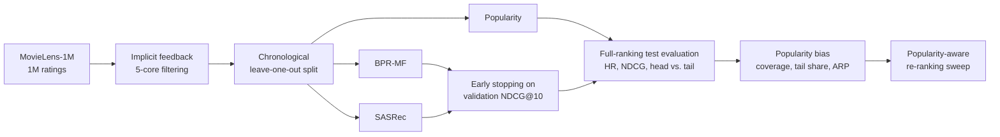
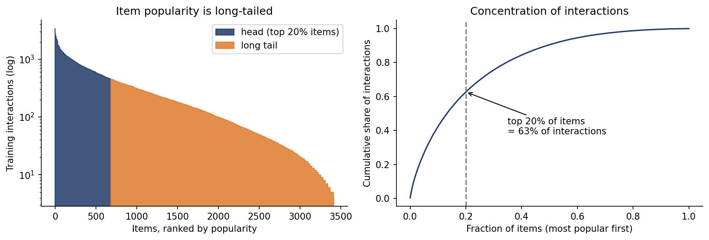
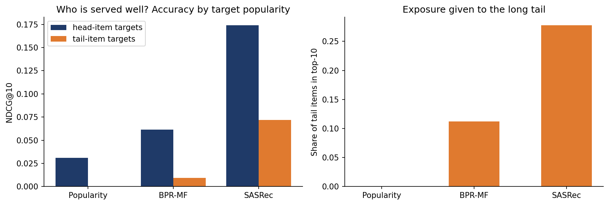
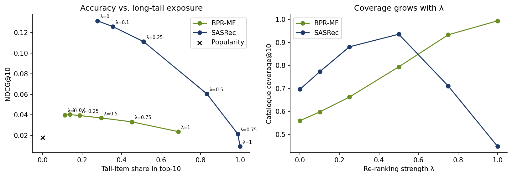

<div align="center">

# Long-Tail-Aware Recommendation

**Sequential vs. collaborative recommenders on MovieLens-1M: accuracy, popularity bias, and the cost of fixing it**

[](https://www.python.org/)
[](https://pytorch.org/)
[](notebooks/)
[](LICENSE)
[](https://colab.research.google.com/github/Souhaila-DJAFFAL/longtail-recsys/blob/main/notebooks/01_data_preparation_and_eda.ipynb)

</div>

---

## Overview

Recommender systems decide what millions of users see, and they are usually tuned for one number:
how often the next item a user consumes appears in the top-10. Optimizing only that number tends to
**concentrate exposure on a small set of popular items**, so niche content is rarely surfaced and users
with less mainstream tastes are served worse.

This project builds and compares three recommenders, from a popularity baseline to a Transformer-based
sequential model, and evaluates them on **both accuracy and popularity bias**:

* **SASRec**: a causal self-attention model that predicts a user's next item from the order of their history.
* **BPR-MF**: matrix factorization trained with a pairwise ranking loss (collaborative filtering).
* **Popularity**: a non-personalized reference.

It then applies **popularity-aware re-ranking** and measures how much long-tail exposure can be gained
for a given loss in accuracy.

### Questions answered

1. How much does modelling the **order** of interactions (SASRec) improve over collaborative filtering (BPR-MF)?
2. Are accuracy gains shared by **all users**, or concentrated on users whose next item is already popular?
3. How much **catalogue coverage and long-tail exposure** can re-ranking buy, and at what accuracy cost?

---

## Pipeline



---

## Notebooks

**Quickest way to reproduce everything:** open [`00_run_all.ipynb`](notebooks/00_run_all.ipynb) in Colab
[](https://colab.research.google.com/github/Souhaila-DJAFFAL/longtail-recsys/blob/main/notebooks/00_run_all.ipynb),
choose a **T4 GPU** runtime and *Run all*. It executes notebooks 01 → 05 in one session (about 15–25 minutes)
and saves them with their outputs. Locally, run the notebooks in order in one Jupyter server.

| # | Notebook | What it does | |
|---|---|---|---|
| 01 | [Data preparation & EDA](notebooks/01_data_preparation_and_eda.ipynb) | Downloads MovieLens-1M, 5-core filtering, leave-one-out split, quantifies the long tail | [](https://colab.research.google.com/github/Souhaila-DJAFFAL/longtail-recsys/blob/main/notebooks/01_data_preparation_and_eda.ipynb) |
| 02 | [Models](notebooks/02_models.ipynb) | Popularity, BPR-MF and SASRec in PyTorch, with the maths behind each | [](https://colab.research.google.com/github/Souhaila-DJAFFAL/longtail-recsys/blob/main/notebooks/02_models.ipynb) |
| 03 | [Evaluation metrics](notebooks/03_evaluation_metrics.ipynb) | Full-ranking protocol, accuracy and long-tail metrics, re-ranking, built-in self-tests | [](https://colab.research.google.com/github/Souhaila-DJAFFAL/longtail-recsys/blob/main/notebooks/03_evaluation_metrics.ipynb) |
| 04 | [Training](notebooks/04_training.ipynb) | Negative sampling, BPR and next-item BCE training, early stopping, learning curves | [](https://colab.research.google.com/github/Souhaila-DJAFFAL/longtail-recsys/blob/main/notebooks/04_training.ipynb) |
| 05 | [Results & long-tail analysis](notebooks/05_results_and_longtail_analysis.ipynb) | Test results, head- vs. tail-user accuracy, accuracy/exposure trade-off, findings | [](https://colab.research.google.com/github/Souhaila-DJAFFAL/longtail-recsys/blob/main/notebooks/05_results_and_longtail_analysis.ipynb) |

Notebooks 02 and 03 hold the model and metric definitions; 04 and 05 load them with `%run`, so every
definition lives in exactly one place.

---

## Results

<!-- RESULTS:START -->
MovieLens-1M after 5-core filtering: 6,040 users, 3,416 items. Test set = each user's last interaction;
full ranking over all items; K = 10. Single run, seed 42, trained on a Colab T4 GPU.

### The data is long-tailed

The 20% most popular items receive **63%** of training interactions, and for **42%** of users the next
item they actually watched is a long-tail item.



### Model comparison

| Model | HR@10 | NDCG@10 | NDCG@10 (head targets) | NDCG@10 (tail targets) | Coverage@10 | Tail share@10 |
|:--|--:|--:|--:|--:|--:|--:|
| Popularity | 0.0369 | 0.0180 | 0.0309 | 0.0000 | 5.8% | 0.0% |
| BPR-MF | 0.0801 | 0.0399 | 0.0616 | 0.0095 | 56.0% | 11.2% |
| **SASRec** | **0.2459** | **0.1315** | **0.1739** | **0.0721** | **69.6%** | **27.8%** |



### Accuracy vs. long-tail exposure under re-ranking



| SASRec, λ | NDCG@10 | NDCG@10 (tail targets) | Coverage@10 | Tail share@10 |
|:--|--:|--:|--:|--:|
| 0 (no re-ranking) | 0.1315 | 0.0721 | 69.6% | 27.8% |
| 0.1 | 0.1259 (−4.3%) | 0.0819 (+13.6%) | 77.3% | 35.5% |
| 0.25 | 0.1112 (−15.4%) | 0.0904 (+25.4%) | 88.1% | 51.1% |
| 0.5 | 0.0604 | 0.0756 | 93.6% | 83.2% |
| 1.0 | 0.0094 | 0.0223 | 44.8% | 100.0% |

Full tables: [`results/results_ml-1m.md`](results/results_ml-1m.md) · learning curves: [`results/learning_curves.png`](results/learning_curves.png)

### Key findings

1. **Sequence order matters.** SASRec more than triples BPR-MF's NDCG@10 (0.1315 vs. 0.0399) and is
   7× better than the popularity baseline, showing that recent viewing order carries strong signal on MovieLens.
2. **The sequential model is also the less biased one.** SASRec's largest relative gain is for users whose
   next item is in the long tail (NDCG@10 0.0721 vs. 0.0095, ~7.6×, compared with ~2.8× for head-item
   targets). It also recommends 2.5× more tail items and covers more of the catalogue than BPR-MF.
3. **A small amount of re-ranking is close to free.** At λ = 0.1, SASRec gives up 4.3% NDCG@10 but
   improves accuracy for tail-item users by 13.6% and raises catalogue coverage from 69.6% to 77.3%.
   For BPR-MF, λ = 0.1 even slightly improves NDCG@10 (0.0399 → 0.0403).
4. **Over-correction backfires.** Beyond λ ≈ 0.5, the popularity penalty dominates the model's scores:
   tail share approaches 100% but coverage *falls* (to 44.8% at λ = 1) because every user receives
   the same set of obscure items, and accuracy collapses for head and tail users alike.

**Takeaway for a production platform:** choose a sequential model first, then a mild re-ranking strength
(λ ≈ 0.1–0.25) as a tunable lever, and validate it online (A/B test) with engagement and
catalogue-exposure metrics side by side.
<!-- RESULTS:END -->

---

## Methodology

| | Choice | Why |
|---|---|---|
| **Data** | MovieLens-1M, every rating = implicit positive, 5-core filtering | Mirrors click/view logs used in production |
| **Split** | Per user, chronological: last item → test, second-to-last → validation | Evaluates *next-item* prediction without leaking the future |
| **Ranking** | Full ranking over all ~3.7k items, seen items excluded, pessimistic ties | Sampled-negative metrics can reorder models (Krichene & Rendle, 2020) |
| **Accuracy** | HR@10, NDCG@10, and NDCG@10 split by head-item vs. tail-item targets | Shows *which* users benefit from a model |
| **Bias** | Coverage@10, tail-item share (APLT), average recommendation popularity (ARP) | Standard popularity-bias measures (Abdollahpouri et al., 2019) |
| **Head / tail** | Head = top 20% of items by training popularity | Pareto-style split, computed on training data only |
| **Mitigation** | `z(score) − λ · z(log popularity)`, λ ∈ {0, …, 1} | Model-agnostic post-processing; traces the full trade-off curve |
| **Model selection** | Early stopping on validation NDCG@10; test set used once, in notebook 05 | Clean separation of tuning and reporting |

**Model details.** SASRec: 2 pre-norm causal self-attention blocks, 64-d embeddings, max sequence length 200,
dropout 0.2, BCE loss with one sampled negative per position. BPR-MF: 64-d embeddings, Adam, BPR loss
with uniformly sampled negatives.

---

## Quickstart

```bash
git clone https://github.com/Souhaila-DJAFFAL/longtail-recsys.git
cd longtail-recsys
pip install -r requirements.txt
jupyter lab notebooks/        # run 01 → 05
```

A synthetic dataset with the same long-tail structure runs the whole pipeline in under a minute on CPU,
which is useful for checking changes:

```bash
RECSYS_DATASET=synthetic RECSYS_QUICK=1 jupyter lab notebooks/
```

---

## Repository structure

```
longtail-recsys/
├── notebooks/
│   ├── 00_run_all.ipynb               # runs 01 → 05 in one Colab session
│   ├── 01_data_preparation_and_eda.ipynb
│   ├── 02_models.ipynb
│   ├── 03_evaluation_metrics.ipynb
│   ├── 04_training.ipynb
│   └── 05_results_and_longtail_analysis.ipynb
├── results/          # tables (CSV, Markdown) and figures written by the notebooks
├── requirements.txt
└── LICENSE
```

Downloaded data (`data/`) and model checkpoints (`artifacts/`) are created locally and not committed.

---

## Limitations and next steps

* Offline evaluation on one public dataset with a single seed: next, multiple seeds with confidence intervals.
* Uniform negative sampling: next, popularity-aware or hard negatives.
* Re-ranking is post-hoc: next, in-training debiasing (e.g., inverse propensity weighting) and personalized re-ranking.
* Larger and sparser catalogues (e.g., e-commerce data), where the long tail is far heavier than in MovieLens.

---

## References

* W.-C. Kang and J. McAuley. *Self-Attentive Sequential Recommendation.* ICDM 2018.
* S. Rendle, C. Freudenthaler, Z. Gantner and L. Schmidt-Thieme. *BPR: Bayesian Personalized Ranking from Implicit Feedback.* UAI 2009.
* W. Krichene and S. Rendle. *On Sampled Metrics for Item Recommendation.* KDD 2020.
* H. Abdollahpouri, R. Burke and B. Mobasher. *Managing Popularity Bias in Recommender Systems with Personalized Re-ranking.* FLAIRS 2019.
* F. M. Harper and J. A. Konstan. *The MovieLens Datasets: History and Context.* ACM TiiS 2015.

---

## Author

**Souhaila Djaffal**: PhD candidate in Computer Science, machine learning researcher based in Doha, Qatar.
[GitHub](https://github.com/Souhaila-DJAFFAL) · [LinkedIn](https://www.linkedin.com/in/souhaila-djaffal-889661b8/) · [ORCID](https://orcid.org/0009-0001-6217-0916)

Released under the [MIT License](LICENSE). MovieLens data © GroupLens Research, used under its terms and not redistributed here.
